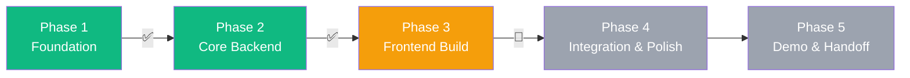

# 📊 SK AKSES — Project Status

> **Progress Tracker** — This document records the project's progression through its development phases.
> It serves as the single source of truth for where the project stands and what comes next.

**Last Updated:** 2026-08-17

---

## 1. Main Goal

**Deliver a fully functional, locally-hosted prototype of the SK AKSES (Katips) portal to the Sangguniang Kabataan council for stakeholder demo and approval, validating the concept and architecture before investing in cloud infrastructure and production deployment.**

---

## 2. Development Phases

| Phase | Name                 | Status         | Target |
| ----- | -------------------- | -------------- | ------ |
| 1     | Foundation & Setup   | ✅ Complete    | —      |
| 2     | Core Backend & APIs  | ✅ Complete    | —      |
| 3     | Frontend Build       | 🔄 In Progress | —      |
| 4     | Integration & Polish | ⬜ Not Started | —      |
| 5     | Demo & Handoff       | ⬜ Not Started | —      |

---

## 3. Phase Details

### Phase 1: Foundation & Setup ✅

**Goal:** Establish the development environment, tooling, and project infrastructure.

| Task                                                  | Status  | Notes                                     |
| ----------------------------------------------------- | ------- | ----------------------------------------- |
| Initialize Git repository                             | ✅ Done | Pushed to GitHub                          |
| Set up monorepo structure (root + backend + frontend) | ✅ Done | Root package.json with workspace scripts  |
| Configure backend (Express.js + SQLite)               | ✅ Done | `server.js` entry point, `better-sqlite3` |
| Configure frontend (Next.js App Router)               | ✅ Done | Next.js 16 with App Router                |
| Design database schema (V1 — core tables)             | ✅ Done | 14 tables in `migrations.js`              |
| Design database schema (V2 — expansion modules)       | ✅ Done | 23 tables in `migrations_v2.js`           |
| Set up ESLint + Prettier (backend + frontend)         | ✅ Done | Dual config files, eslint-config-prettier |
| Set up Husky + lint-staged                            | ✅ Done | Pre-commit hooks enforced                 |
| Create `.gitignore`                                   | ✅ Done | Comprehensive exclusions                  |
| Create `CONTRIBUTING.md`                              | ✅ Done | Branch naming, commits, PR workflow       |
| Create design system (`globals.css`)                  | ✅ Done | Color tokens, typography, animations      |
| Create project documentation (`docs/`)                | ✅ Done | architecture, design, boundaries, status  |

---

### Phase 2: Core Backend & APIs ✅

**Goal:** Build all REST API endpoints, authentication, and middleware.

| Task                                  | Status  | Notes                                       |
| ------------------------------------- | ------- | ------------------------------------------- |
| JWT Authentication (login/register)   | ✅ Done | `routes/auth.js`, `middleware/auth.js`      |
| User management API                   | ✅ Done | Profile, profiling data, role management    |
| Community Forum API (CRUD + likes)    | ✅ Done | Threads, replies, thread likes              |
| News & Announcements API              | ✅ Done | CRUD with poster image upload               |
| Services API (catalog + logs)         | ✅ Done | Service requests with status tracking       |
| SKill Up API (events + tickets)       | ✅ Done | Full event lifecycle, registration, tickets |
| Rewards API (catalog + redemptions)   | ✅ Done | Points-based reward system                  |
| Transparency API                      | ✅ Done | Document publishing                         |
| Notifications API                     | ✅ Done | System notifications                        |
| E-Panukala API (proposals + voting)   | ✅ Done | Upvotes, mandatory agenda threshold         |
| Bantay-Pondo API (budget tracking)    | ✅ Done | Categories, allocations, expenditures       |
| Bantay-Komunidad API (hazard reports) | ✅ Done | Geo-tagged reports with severity            |
| SafeSpace API (confidential reports)  | ✅ Done | Counselor assignment, audit logging         |
| Gig Board API                         | ✅ Done | Postings, applications                      |
| Scholarships API                      | ✅ Done | Listings, applications                      |
| Resource Bank API                     | ✅ Done | Resources, tutor requests                   |
| Exchange Opportunities API            | ✅ Done | Opportunity listings                        |
| Eco-Points API                        | ✅ Done | Activities, point transactions              |
| Agri-Connect API                      | ✅ Done | Content, seed kit requests + inventory      |
| VolunTinder API                       | ✅ Done | Opportunities, swipe actions                |
| Dashboard stats endpoint              | ✅ Done | Aggregated admin statistics                 |
| Health check endpoint                 | ✅ Done | `GET /api/health`                           |
| Seed data (V1 + V2)                   | ✅ Done | Development seed data for all tables        |

---

### Phase 3: Frontend Build 🔄

**Goal:** Build all user-facing and admin-facing pages with the design system.

| Task                                       | Status         | Notes                                    |
| ------------------------------------------ | -------------- | ---------------------------------------- |
| Landing page                               | ✅ Done        | Hero section, features, CTA              |
| Login page                                 | ✅ Done        | JWT-based login                          |
| Registration page                          | ✅ Done        | Youth registration flow                  |
| Portal layout (sidebar + topbar)           | ✅ Done        | Responsive layout with navigation        |
| Sidebar component                          | ✅ Done        | Role-aware navigation                    |
| User Dashboard                             | ✅ Done        | Stats, recent activity                   |
| Community Forum (threads + replies)        | ✅ Done        | Full CRUD with likes and categories      |
| News & Announcements feed                  | ✅ Done        | Cards with poster images                 |
| SKill Up (events + registration + tickets) | ✅ Done        | Event feed, detail modal, digital ticket |
| User Profile (display + youth profiling)   | ✅ Done        | Tabbed interface, confirmation prompts   |
| Transparency Board                         | ✅ Done        | Document viewing                         |
| Services Hub (index page)                  | ✅ Done        | Module cards linking to sub-services     |
| E-Panukala page                            | 🔄 In Progress | Proposal creation and voting UI          |
| Bantay-Pondo page                          | 🔄 In Progress | Budget visualization                     |
| Bantay-Komunidad page                      | 🔄 In Progress | Hazard reporting UI                      |
| Gig Board page                             | 🔄 In Progress | Listings and application flow            |
| Edu Hub / Skill Share pages                | ⬜ Not Started | Scholarship + resource browser           |
| Youth Exchange page                        | ⬜ Not Started | Opportunity listings                     |
| Eco-Points page                            | ⬜ Not Started | Activity log and point balance           |
| Agri-Connect page                          | ⬜ Not Started | Content guides, seed kit request         |
| VolunTinder page                           | ✅ Done        | Swipe UI for volunteer matching          |
| SafeSpace page                             | ✅ Done        | Confidential reporting form              |
| Admin Dashboard                            | ✅ Done        | Overview stats                           |
| Admin — Forum Moderation                   | ✅ Done        | Thread management                        |
| Admin — News Management                    | ✅ Done        | CRUD with image upload                   |
| Admin — Services Management                | ✅ Done        | Service catalog + log management         |
| Admin — SKill Up Management                | ✅ Done        | Event CRUD, attendee management          |
| Admin — Rewards Management                 | ✅ Done        | Catalog management                       |
| Admin — User Management                    | ✅ Done        | Role changes, verification               |
| Admin — SafeSpace Panel                    | ✅ Done        | Counselor case management                |
| Admin — Transparency Management            | ✅ Done        | Document upload/publish                  |
| Admin — Expansion module management pages  | ⬜ Not Started | Admin CRUD for expansion modules         |

---

### Phase 4: Integration & Polish ⬜

**Goal:** Connect all frontend pages to backend APIs, fix bugs, and polish UX.

| Task                                       | Status         | Notes                                     |
| ------------------------------------------ | -------------- | ----------------------------------------- |
| End-to-end integration testing             | ⬜ Not Started |                                           |
| SKill Up points ↔ Rewards integration      | ⬜ Not Started | Points earned → rewards redeemable        |
| Eco-Points ↔ SKill Up points merge         | ⬜ Not Started | Unified point economy                     |
| Empty states for all list views            | ⬜ Not Started | Friendly messages + CTAs                  |
| Loading/skeleton states                    | ⬜ Not Started | Shimmer animations                        |
| Error handling & toast system              | 🔄 Partial     | Basic toasts exist, needs standardization |
| Responsive testing (mobile/tablet/desktop) | ⬜ Not Started |                                           |
| Cross-browser testing                      | ⬜ Not Started |                                           |
| Form validation consistency                | ⬜ Not Started |                                           |
| Navigation flow review                     | ⬜ Not Started |                                           |
| Performance audit                          | ⬜ Not Started |                                           |
| Accessibility audit                        | ⬜ Not Started |                                           |

---

### Phase 5: Demo & Handoff ⬜

**Goal:** Present the completed prototype to stakeholders and gather approval for production planning.

| Task                                   | Status         | Notes                                 |
| -------------------------------------- | -------------- | ------------------------------------- |
| Prepare demo script / walkthrough      | ⬜ Not Started |                                       |
| Seed database with realistic demo data | ⬜ Not Started |                                       |
| Stakeholder presentation               | ⬜ Not Started | Present to SK Council                 |
| Gather feedback                        | ⬜ Not Started |                                       |
| Document production requirements       | ⬜ Not Started | Cloud, domain, scaling needs          |
| Archive prototype branch               | ⬜ Not Started | Tag release, create production branch |

---

## 4. Sprint History

### Sprint 1: Project Infrastructure ✅

| Task # | Description                     | Status  | Assignee | PR/Branch                            |
| ------ | ------------------------------- | ------- | -------- | ------------------------------------ |
| 1.6    | ESLint + Prettier configuration | ✅ Done | —        | `chore/s1-1.6/setup-eslint-prettier` |
| 1.7    | Husky + lint-staged setup       | ✅ Done | —        | `chore/s1-1.7/husky-lint-staged`     |
| 1.8    | Project-specific .gitignore     | ✅ Done | —        | `chore/s1-1.8/project-gitignore`     |
| 1.11   | CONTRIBUTING.md guidelines      | ✅ Done | —        | `docs/s1-1.11/contributing-guide`    |

---

## 5. Key Metrics

| Metric               | Count | Notes                             |
| -------------------- | ----- | --------------------------------- |
| Backend route files  | 20    | All API modules implemented       |
| Database tables (V1) | 14    | Core schema                       |
| Database tables (V2) | 23    | Expansion modules (+app_config)   |
| Frontend pages       | ~30   | Portal, admin, services, auth     |
| Reusable components  | 4     | Sidebar, YouthProfilingForm + CSS |
| API endpoints        | ~80+  | Across all route files            |

---

## 6. Known Issues & Technical Debt

| Issue                                           | Severity | Filed    |
| ----------------------------------------------- | -------- | -------- |
| EPERM file lock error on Next.js (intermittent) | Medium   | Known    |
| Some migration scripts have hardcoded seeds     | Low      | Known    |
| No unified error handling middleware            | Medium   | Backlog  |
| Toast notification system not standardized      | Low      | Backlog  |
| No automated tests                              | High     | Phase 4  |
| `.db` files not auto-excluded from Git tracking | Low      | Resolved |

---

## 7. Change Log

| Date       | Change                                                                            | Author |
| ---------- | --------------------------------------------------------------------------------- | ------ |
| 2026-08-17 | Created `docs/` directory with architecture, design, boundaries, and status files | System |
| 2026-08-14 | Completed Sprint 1 infrastructure tasks (ESLint, Husky, .gitignore, CONTRIBUTING) | —      |
| 2026-08-12 | Began SK AKSES SaaS architecture planning (multi-tenant design)                   | —      |
| 2026-08-10 | Renamed project direction from Katips prototype to SK AKSES                       | —      |
| 2026-07-31 | Initial GitHub push with full codebase                                            | —      |
| 2026-07-29 | Completed Expansion Modules (SafeSpace, VolunTinder, Eco-Points, Agri-Connect)    | —      |
| 2026-07-28 | Enhanced SKill Up event system with tickets and poster uploads                    | —      |
| 2026-07-28 | Improved user profile with tabbed interface and youth profiling                   | —      |

---

> **⚠️ Update Protocol:** This file must be updated whenever:
>
> - A task changes status (Not Started → In Progress → Done)
> - A sprint is completed
> - A new phase begins
> - A significant issue is discovered or resolved
> - A key metric changes materially
